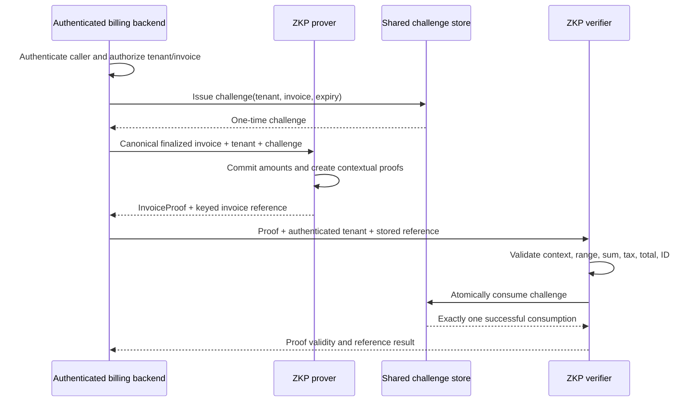

# Architecture and Trust Boundaries

## Components

- `src/zkp_core.py`: custom secp256k1 arithmetic, Pedersen commitments,
  Schnorr proofs, OR range proofs, and the strict tax-remainder relation proof.
- `src/billing_zkp.py`: canonical invoice model, proof composition, validation,
  trusted-reference comparison, and one-time challenge consumption.
- `src/crypto_utils.py`: canonical hashing, HKDF key derivation, strict proof
  serialization, and context-bound timestamp MACs.
- `src/replay.py`: challenge-store protocol and SQLite implementation with
  transactionally atomic consumption.
- `src/api.py`: Flask blueprint factory. The host injects authentication,
  tenant-scoped canonical invoice loading, trusted-reference lookup, keys, and
  replay storage.

## Proof generation and verification

### Public statement and witnesses

Public proof metadata includes tenant ID, invoice ID, currency, tax rate in
basis points, item count, proof context, commitments, keyed invoice reference,
timestamp token, and challenge. Witnesses include line-item amounts, subtotal,
tax, total, Pedersen blindings, and the tax remainder. See
[`CRYPTOGRAPHY.md`](./CRYPTOGRAPHY.md) for the actual verification equations
and value bounds.

The public tax rate and item count are intentionally disclosed. The verifier
does not learn monetary witness values from the protocol statements, subject
to the limitations of this custom implementation. Invoice IDs and tenant IDs
are public metadata.

## Authentication and tenancy

`create_zkp_blueprint` requires:

1. `authenticate(request) -> Principal | None`. The host must authenticate
   credentials and set `can_prove` / `can_verify` appropriately.
2. `load_invoice(invoice_id, tenant_id)`. The host must return only finalized
   canonical records owned by that tenant.
3. `resolve_invoice_hash(invoice_id, tenant_id)`. The host must return a
   previously persisted keyed reference for that record, not a value supplied
   by the API caller.
4. A shared key manager and challenge store.

The host remains responsible for authorization policy, tenant isolation,
database integrity, secrets-manager access, network controls, and business
idempotency. The unconfigured `zkp_bp` compatibility object returns `503`
rather than enabling unsafe defaults.

## Challenge lifecycle

The verifier issues a cryptographically random challenge bound in storage to
one tenant, invoice ID, and expiry time. It is included in every proof
transcript. After all checks and any required reference comparison succeed,
the verifier atomically changes the challenge from unused to consumed.
Repeated or concurrent submissions cannot both succeed.

The SQLite implementation is suitable only when workers share the same local
database file. Multi-host deployments must inject a transactional shared-store
implementation. Expired and consumed rows are removed during later issuance;
retention/cleanup policy for other storage implementations is deployment
specific.

## Trust and non-guarantees

- A valid proof means the checked algebraic statements validate under this
  implementation; it does not independently establish who issued the invoice.
- A trusted-reference match confirms equality to the value supplied by the
  authenticated host. It is only as trustworthy as that source and its
  access-control policy.
- Proof transcript binding prevents changing metadata without invalidating the
  proof; it is not an invoice-ID signature.
- The project is custom pure Python and has no independent cryptographic audit
  or formal security proof. No production guarantee is made.

